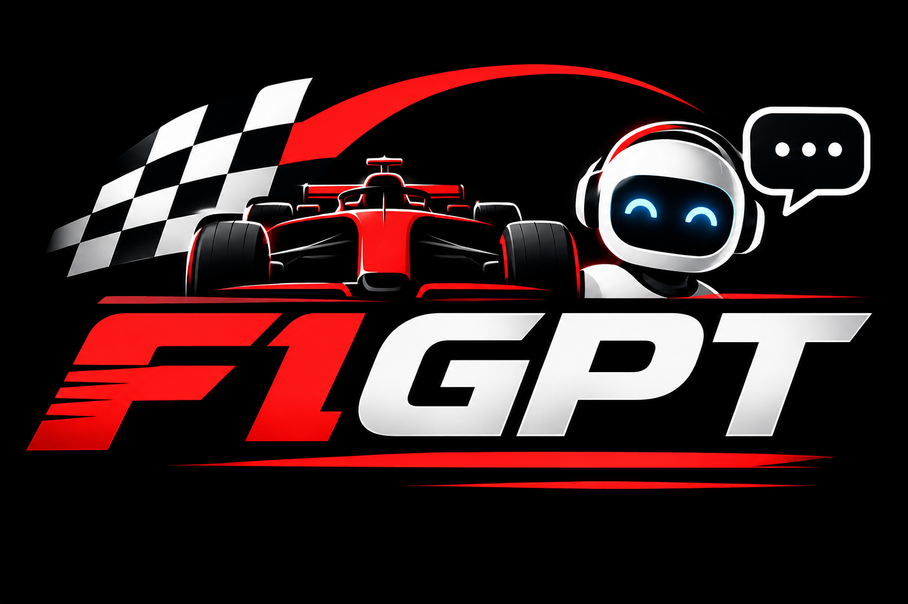
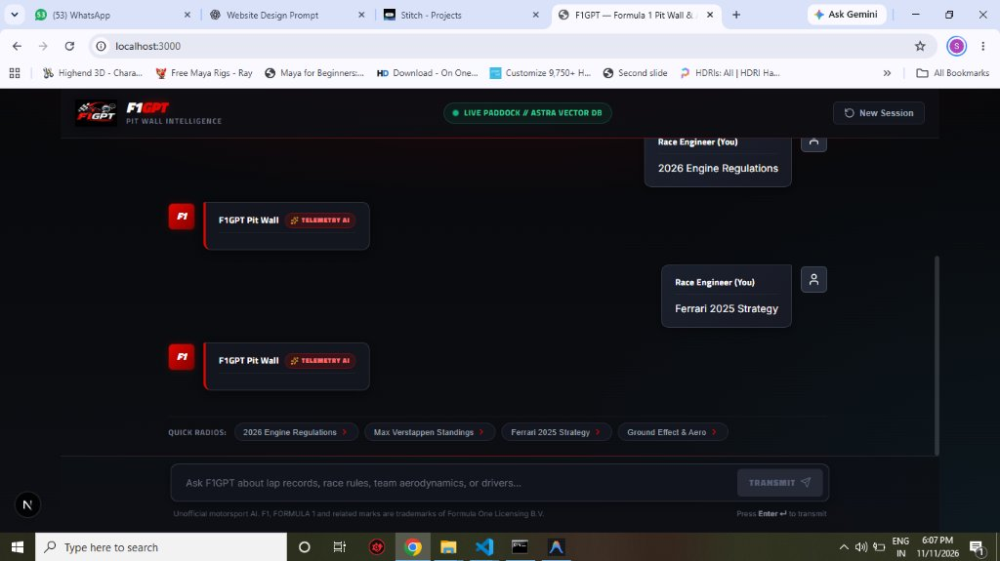
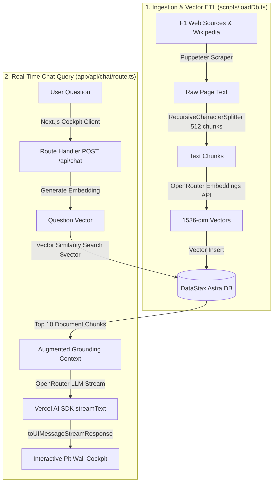

<div align="center">

  

  # F1GPT — Formula 1 Pit Wall & AI Race Intelligence

  **Real-Time Motorsport Engineering Companion powered by Retrieval-Augmented Generation (RAG), DataStax Astra DB Vector Search, and OpenRouter.**

  [](https://nextjs.org/)
  [](https://react.dev/)
  [](https://www.typescriptlang.org/)
  [](https://astra.datastax.com/)
  [](https://sdk.vercel.ai/)
  [](https://openrouter.ai/)

</div>

---

## 📸 Cockpit Interface

<div align="center">
  
  <p><em>F1GPT Live Cockpit: Dark motorsport carbon styling, live telemetry indicator, 5 red starting grid lights, and categorized suggestion pills.</em></p>
</div>

---

## 📑 Table of Contents

- [Overview](#-overview)
- [Key Features](#-key-features)
- [System Architecture](#-system-architecture)
- [Tech Stack](#-tech-stack)
- [Getting Started](#-getting-started)
  - [Prerequisites](#prerequisites)
  - [1. Clone Repository](#1-clone-repository)
  - [2. Install Dependencies](#2-install-dependencies)
  - [3. Environment Variables](#3-environment-variables)
  - [4. Seed the Vector Database](#4-seed-the-vector-database)
  - [5. Run Development Server](#5-run-development-server)
- [DataStax Astra DB Setup](#-datastax-astra-db-setup)
- [OpenRouter & Dynamic Model Switching](#-openrouter--dynamic-model-switching)
- [Project Structure](#-project-structure)
- [Available Scripts](#-available-scripts)
- [Keyboard Shortcuts](#-keyboard-shortcuts)
- [Troubleshooting & FAQs](#-troubleshooting--faqs)
- [Disclaimer](#-disclaimer)

---

## 🏁 Overview

**F1GPT** is a Formula 1 engineering and intelligence assistant designed for motorsport enthusiasts, analysts, and engineers. Rather than relying on static generic LLM knowledge that may hallucinate or lack current regulatory context, F1GPT employs **Retrieval-Augmented Generation (RAG)**:

1. **Automated Scraping (ETL):** Ingests technical regulations, Grand Prix calendars, driver standings, and team news from verified motorsport sources using **Puppeteer** and **LangChain**.
2. **Vector Embeddings:** Transforms raw document chunks into 1536-dimensional semantic vectors via `openai/text-embedding-3-small`.
3. **High-Performance Storage:** Indexes vector representations in a serverless **DataStax Astra DB** collection using dot-product similarity search.
4. **Context Injection:** Matches incoming user queries against the vector database, fetching the top 10 most relevant documents as grounded context.
5. **Real-Time Streaming:** Streams responses via the **Vercel AI SDK**, complete with markdown tables, telemetry thoughts, and driver standings.

---

## ⚡ Key Features

- 🏎️ **F1 Pit Wall Design System:** Dark carbon aesthetic (`#07080a`), official FIA Formula 1 Racing Red (`#e10600`), sleek glassmorphism, and motorsport typography (`Titillium Web` & `Inter`).
- 🚦 **5 Red Starting Grid Lights:** Custom animated loading indicator mimicking the iconic Formula 1 Grand Prix starting gantry lights sequence.
- 🧠 **Vector RAG Architecture:** Astra DB vector similarity indexing ensuring accurate race records, driver lineups, and aerodynamic regulations.
- 💡 **Deep Telemetry Reasoning Accordion:** When using reasoning models (such as DeepSeek-R1), chains of thought are separated into an interactive telemetry analysis drawer.
- 🎯 **Categorized Suggestion Matrix:** Hero screen with filterable tabs (*All*, *Championship*, *Drivers*, *Strategy*, *Tech*) for immediate one-click race questions.
- 📻 **Quick Radio Chips:** In-chat suggestion pills to quickly pivot discussions without manual typing.
- 📊 **Responsive Markdown & Standings Tables:** Full Markdown support with horizontally scrollable tables for championship tables, tire comparisons, and race statistics.
- 📥 **Telemetry Transcript Export:** 1-click export to download entire Q&A sessions as formatted Markdown (`.md`) files with timestamped metadata.
- 🔄 **Live AI Model Selector:** Interactive cockpit dropdown to switch AI engines on the fly (`GPT-4o Mini`, `DeepSeek R1`, `Gemini 2.0 Flash`, `Llama 3.3 70B`, `Claude 3.5 Sonnet`) with persistent `localStorage` memory and request-level `.env` fallback.
- ⌨️ **Ergonomic Keyboard Navigation:** <kbd>Ctrl</kbd> + <kbd>K</kbd> (or <kbd>Cmd</kbd> + <kbd>K</kbd>) to focus the cockpit input, <kbd>Escape</kbd> to blur, and a floating **Scroll-to-Bottom FAB** when reviewing earlier messages.
- 📱 **Mobile-Optimized Cockpit:** Built with `100dvh` dynamic viewport scaling to avoid mobile keyboard overlaps.

---

## 🏗️ System Architecture



---

## 🛠️ Tech Stack

| Component | Technology | Description |
| :--- | :--- | :--- |
| **Framework** | [Next.js 16 (App Router)](https://nextjs.org/) | React full-stack framework with Turbopack |
| **Frontend UI** | [React 19](https://react.dev/) | Client components, hooks, and streaming interfaces |
| **AI Integration** | [Vercel AI SDK 7](https://sdk.vercel.ai/) | `streamText`, `useChat`, and `toUIMessageStreamResponse` |
| **Vector Database** | [DataStax Astra DB](https://astra.datastax.com/) | Serverless vector database with `@datastax/astra-db-ts` |
| **LLM Gateway** | [OpenRouter](https://openrouter.ai/) | Unified API gateway for GPT-4o-mini, Gemini, DeepSeek, Llama |
| **Embeddings** | `openai/text-embedding-3-small` | 1536-dimensional float vector embeddings |
| **Web Scraping** | [Puppeteer](https://pptr.dev/) | Headless browser for scraping JS-rendered motorsport pages |
| **Text Processing** | [LangChain Text Splitters](https://js.langchain.com/) | Recursive character chunking (512 chunk size, 100 overlap) |
| **Styling** | Vanilla CSS Design Tokens | High-performance CSS with glassmorphism and custom grid lights |
| **Icons & Fonts** | [Lucide React](https://lucide.dev/) + Google Fonts | `Titillium Web` & `Inter` motorsport typography |
| **Language** | [TypeScript 5](https://www.typescriptlang.org/) | End-to-end type safety |

---

## 🚀 Getting Started

### Prerequisites

- **Node.js**: v18.18 or higher (v20+ recommended)
- **DataStax Astra DB**: Free serverless account ([Create free account](https://astra.datastax.com/))
- **OpenRouter Account**: API Key ([Get OpenRouter key](https://openrouter.ai/keys))

---

### 1. Clone Repository

```bash
git clone https://github.com/your-username/nextjs-f1gpt.git
cd nextjs-f1gpt
```

---

### 2. Install Dependencies

Install packages using `--legacy-peer-deps` to handle React 19 compatibility across tooling:

```bash
npm install --legacy-peer-deps
```

---

### 3. Environment Variables

Copy the example environment configuration:

```bash
cp .env.example .env
```

Open `.env` and fill in your credentials:

```env
# DataStax Astra DB Configuration
ASTRA_DB_NAMESPACE="default_keyspace"
ASTRA_DB_COLLECTION="f1gpt"
ASTRA_DB_API_ENDPOINT="https://<your-astra-db-id>-<region>.apps.astra.datastax.com"
ASTRA_DB_APPLICATION_TOKEN="AstraCS:..."

# OpenRouter & Model Configuration
OPENROUTER_API_KEY="sk-or-v1-..."
OPENROUTER_CHAT_MODEL="openai/gpt-4o-mini"
```

---

### 4. Seed the Vector Database

Run the automated ETL script to scrape F1 sources, generate vector embeddings, and store them in Astra DB:

```bash
npm run seed
```

> [!NOTE]
> The seed script will:
> 1. Connect to your Astra DB instance.
> 2. Create the `f1gpt` collection with 1536 vector dimensions and dot-product similarity (if it does not already exist).
> 3. Scrape official F1 results, Wikipedia archives, Sky Sports updates, and driver contracts using Puppeteer.
> 4. Split text into 512-token chunks, compute embeddings, and insert vector records.

---

### 5. Run Development Server

```bash
npm run dev
```

Open [http://localhost:3000](http://localhost:3000) in your browser to access the cockpit.

---

## 🗄️ DataStax Astra DB Setup

1. Log in to [DataStax Astra DB](https://astra.datastax.com/).
2. Click **Create Database** and select **Serverless (Vector)**.
3. Configure your database:
   - **Database Name:** `f1gpt`
   - **Keyspace Name:** `default_keyspace`
   - **Cloud Provider & Region:** Select the region closest to you.
4. Once active, locate your **API Endpoint** in the Database Overview dashboard (e.g. `https://<id>-<region>.apps.astra.datastax.com`).
5. Generate an Application Token:
   - Go to **Settings** > **Tokens**.
   - Select role: **Database Administrator**.
   - Click **Generate Token** and copy the string starting with `AstraCS:...`.

---

## ⚙️ OpenRouter & Dynamic Model Switching

F1GPT supports any chat completion model available on [OpenRouter](https://openrouter.ai/models). You can switch models directly from the **cockpit header dropdown** or configure a default via `OPENROUTER_CHAT_MODEL` in `.env`:

### Verified Working Models in Cockpit Selector:
- **`openai/gpt-4o-mini`** — Fast, low latency, standard pit wall engine (Default).
- **`google/gemini-2.5-flash`** — Ultra-fast Google multimodal reasoning.
- **`deepseek/deepseek-chat`** — DeepSeek V3 high-performance conversational intelligence.
- **`meta-llama/llama-3.3-70b-instruct`** — Meta's flagship 70B open model.
- **`anthropic/claude-haiku-4.5`** — Fast, agile, and cost-effective Anthropic intelligence.
- **`qwen/qwen-2.5-72b-instruct`** — Massive 72B parameter motorsport reasoning engine.

> [!TIP]
> The backend receives your chosen model dynamically in every request body and passes it straight to `openrouter(chatModel)`. If no model is specified by the client, it seamlessly falls back to `OPENROUTER_CHAT_MODEL` in `.env`. When you select a reasoning model (such as `deepseek/deepseek-r1:free`), the UI automatically renders the expandable **Telemetry Reasoning** accordion!

---

## 📁 Project Structure

```text
nextjs-f1gpt/
├── app/
│   ├── api/
│   │   └── chat/
│   │       └── route.ts             # Vector similarity search & OpenRouter streaming endpoint
│   ├── assets/
│   │   └── f1GPTLogo1.png           # Formula 1 brand imagery & graphics
│   ├── components/
│   │   ├── Bubble.tsx               # Markdown message bubble, copy button & reasoning accordion
│   │   ├── LoadingBubble.tsx        # 5 Red Starting Grid Lights animated indicator
│   │   ├── PromptSuggestionButton.tsx # Individual prompt suggestion badge card
│   │   └── PromptSuggestionsRow.tsx # Filterable categorized prompt suggestion matrix
│   ├── global.css                   # F1 Pit Wall Design System tokens, animations & layout
│   ├── icon.svg                     # Custom SVG motorsport favicon
│   ├── layout.tsx                   # Font definitions (Titillium Web, Inter) & viewport metadata
│   └── page.tsx                     # Main cockpit view, transcript export & keyboard listeners
├── docs/
│   └── screenshots/
│       ├── logo.png                 # Brand logo banner
│       └── preview.jpg              # App cockpit preview image
├── scripts/
│   └── loadDb.ts                    # Puppeteer scraping + LangChain splitting + Astra DB ETL
├── .env.example                     # Template environment variables
├── .gitignore                       # Git ignored files & patterns
├── eslint.config.mjs                # ESLint configuration
├── next.config.ts                   # Next.js build configuration
├── package.json                     # Dependencies, scripts and engines
├── tsconfig.json                    # TypeScript compiler options
└── README.md                        # Documentation
```

---

## 📜 Available Scripts

| Command | Action |
| :--- | :--- |
| `npm run dev` | Starts the Next.js development server with Turbopack at `http://localhost:3000` |
| `npm run seed` | Runs the ETL script (`ts-node ./scripts/loadDb.ts`) to scrape and populate Astra DB |
| `npm run build` | Compiles the production build for deployment |
| `npm run start` | Starts the Next.js production server |
| `npm run lint` | Runs ESLint checks across the codebase |

---

## ⌨️ Keyboard Shortcuts

| Shortcut | Action |
| :--- | :--- |
| <kbd>Enter</kbd> | Transmit query to F1GPT Pit Wall |
| <kbd>Ctrl</kbd> + <kbd>K</kbd> / <kbd>Cmd</kbd> + <kbd>K</kbd> | Instant focus on telemetry input console |
| <kbd>Escape</kbd> | Blur / dismiss input focus |

---

## 🔧 Troubleshooting & FAQs

<details>
<summary><strong>1. npm install fails with dependency conflict</strong></summary>

React 19 was recently released and some peer libraries may report warnings. Always run installation with:
```bash
npm install --legacy-peer-deps
```
</details>

<details>
<summary><strong>2. Error: Missing environment variable</strong></summary>

Ensure you copied `.env.example` to `.env` and that `ASTRA_DB_API_ENDPOINT`, `ASTRA_DB_APPLICATION_TOKEN`, and `OPENROUTER_API_KEY` are populated with valid tokens.
</details>

<details>
<summary><strong>3. Database seeding fails or times out</strong></summary>

- Check that your Astra DB database status is **Active** and not paused.
- Verify your network allows outbound connections to `apps.astra.datastax.com` and `openrouter.ai`.
- Puppeteer requires a stable internet connection to scrape Wikipedia and F1 sites.
</details>

<details>
<summary><strong>4. OpenRouter returns 429 or Insufficient Credits</strong></summary>

If your OpenRouter balance is \$0, you can switch to any of the free tier models in `.env`:
```env
OPENROUTER_CHAT_MODEL="deepseek/deepseek-r1:free"
# or
OPENROUTER_CHAT_MODEL="google/gemini-2.0-flash-exp:free"
```
</details>

---

## ⚖️ Disclaimer

*F1GPT is an unofficial, independent open-source AI project created for motorsport education, research, and fan interest. F1, FORMULA ONE, FORMULA 1, FIA FORMULA ONE WORLD CHAMPIONSHIP, GRAND PRIX, and associated marks are trademarks of Formula One Licensing B.V. and the Fédération Internationale de l'Automobile (FIA). This project is not affiliated with, endorsed by, or sponsored by Formula 1 companies or teams.*

---

<div align="center">
  <sub>Engineered with ❤️ for the global Formula 1 community.</sub>
</div>
